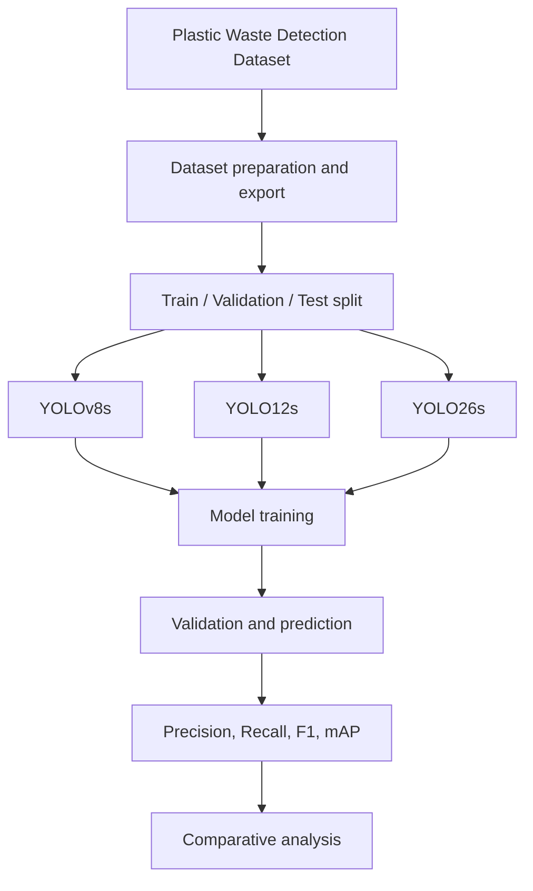
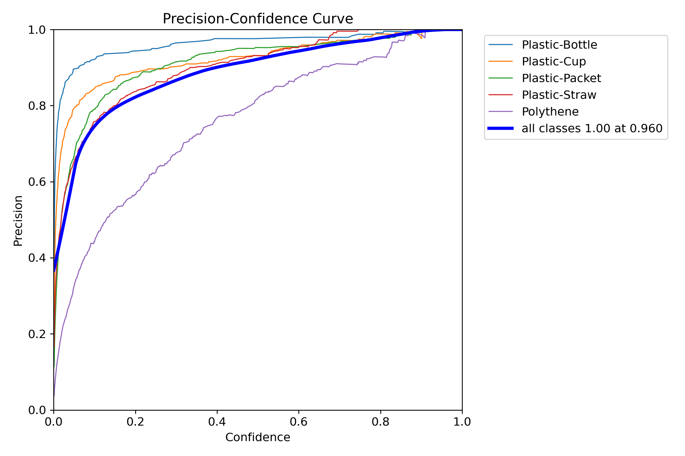
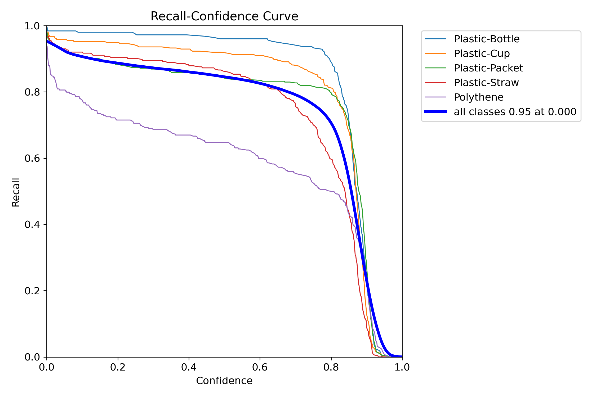
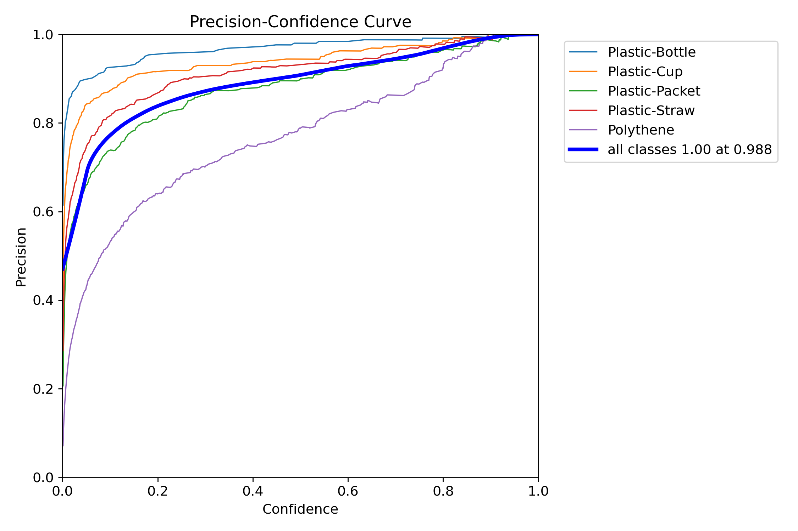
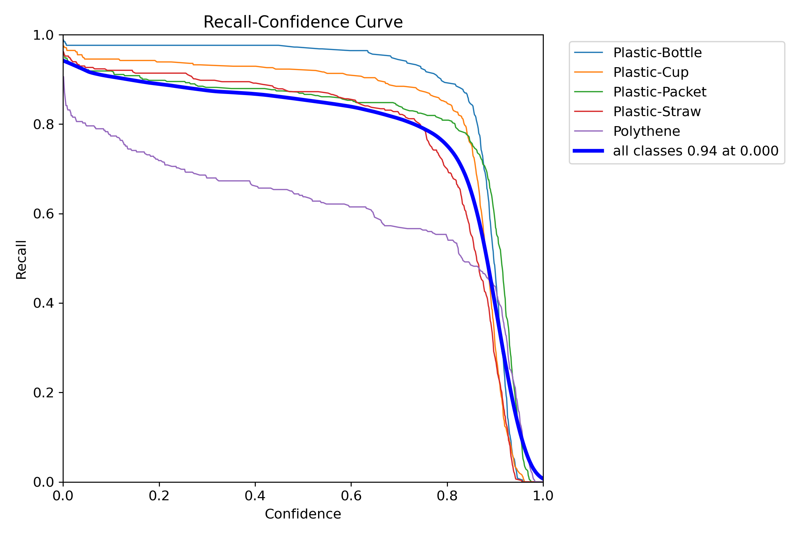

<div align="center">

# Plastic Waste Detection and Classification

**Deep-learning-based plastic waste object detection using YOLOv8s, YOLO12s, and YOLO26s.**

[](https://github.com/tarekrahamn/Plastic-Waste-Detection-and-Classification)


[](https://doi.org/10.17632/wsxmhf8sgv.2)

</div>

---

## Table of Contents

- [Overview](#overview)
- [Project Objectives](#project-objectives)
- [Detection Categories](#detection-categories)
- [Dataset](#dataset)
- [Dataset Statistics](#dataset-statistics)
- [Methodology](#methodology)
- [Experimental Setup](#experimental-setup)
- [Results and Model Comparison](#results-and-model-comparison)
- [Visual Results](#visual-results)
- [Repository Structure](#repository-structure)
- [Getting Started](#getting-started)
- [Reproducibility Notes](#reproducibility-notes)
- [Limitations and Future Work](#limitations-and-future-work)
- [Authors and Contributions](#authors-and-contributions)
- [Dataset Citation](#dataset-citation)
- [License](#license)
- [Acknowledgements](#acknowledgements)

## Overview

Plastic pollution is a major environmental challenge. Automated detection of plastic waste in images can support waste monitoring, sorting, and environmental assessment.

This project investigates deep-learning-based **plastic waste object detection and category recognition** using three YOLO model variants: **YOLOv8s, YOLO12s, and YOLO26s**. Each model was trained for five plastic-waste categories and evaluated using standard object-detection metrics.

The repository includes the model-training notebooks and selected evaluation visualizations.

> **Task clarification:** This project performs object detection: it predicts bounding boxes and category labels for objects in an image. It is not a separate image-level classification pipeline.

## Project Objectives

- Build an object-detection workflow for identifying common plastic-waste items.
- Train and evaluate YOLOv8s, YOLO12s, and YOLO26s.
- Compare model performance using Precision, Recall, F1-score, mAP@50, and mAP@50–95.
- Inspect model behaviour using confusion matrices and evaluation curves.
- Provide a foundation for further research into automated plastic-waste monitoring.

## Detection Categories

The dataset contains five object categories:

| Category |
|---|
| Plastic-Bottle |
| Plastic-Cup |
| Plastic-Packet |
| Plastic-Straw |
| Polythene |

For numeric class IDs, refer to the dataset's `data.yaml` file. The exact class-ID mapping should not be inferred from the order in this table.

## Dataset

The experiments use the **Plastic Waste Detection Dataset**.

- **Dataset DOI:** [10.17632/wsxmhf8sgv.2](https://doi.org/10.17632/wsxmhf8sgv.2)
- **Dataset record:** [Mendeley Data](https://data.mendeley.com/datasets/wsxmhf8sgv/2)
- **Dataset license:** [Creative Commons Attribution 4.0 International (CC BY 4.0)](https://creativecommons.org/licenses/by/4.0/)
- **Dataset workflow/source platform:** [Roboflow](https://roboflow.com/)

The dataset's DOI record is the source of record for dataset attribution and reuse conditions. Please review the original dataset record before redistributing dataset files.

## Dataset Statistics

The dataset contains **6,356 images** and **7,918 annotations** across the training, validation, and test subsets.

| Split | Images | Image Share | Annotations | Annotation Share | Avg. Annotations / Image | Multi-object Images |
|---|---:|---:|---:|---:|---:|---:|
| Training | 4,449 | 70.0% | 5,551 | 70.1% | 1.25 | 726 (16.3%) |
| Validation | 1,271 | 20.0% | 1,578 | 19.9% | 1.24 | 205 (16.1%) |
| Testing | 636 | 10.0% | 789 | 10.0% | 1.25 | 92 (14.5%) |
| **Total** | **6,356** | **100%** | **7,918** | **100%** | **1.25** | **1,023 (16.1%)** |

*Statistics are transcribed from the dataset summary table provided by the project authors.*

## Methodology

The overall workflow consists of dataset preparation, model training, validation, and comparative evaluation.



### Models

- **YOLOv8s**
- **YOLO12s**
- **YOLO26s**

All three models were successfully trained using the project workflow.

### Evaluation Metrics

- **Precision:** Proportion of predicted detections that are correct.
- **Recall:** Proportion of ground-truth objects successfully detected.
- **F1-score:** Harmonic mean of Precision and Recall.
- **mAP@50:** Mean Average Precision at an IoU threshold of 0.50.
- **mAP@50–95:** Mean Average Precision averaged across IoU thresholds from 0.50 to 0.95.

## Experimental Setup

| Parameter | Configuration |
|---|---|
| Framework | Ultralytics |
| Model variants | YOLOv8s, YOLO12s, YOLO26s |
| Training epochs | 50 |
| Input image size | 640 × 640 |
| GPU environment | NVIDIA T4 × 2 |
| Task | Object detection |
| Number of classes | 5 |
| Training status | All three models successfully trained |

The experiments were conducted in a Kaggle GPU environment, as reported by the authors. Follow the setup cells in each notebook for the corresponding model-specific package configuration.

## Results and Model Comparison

The following values are the **final research-paper comparison results confirmed by the authors**.

| Model | Epochs | Precision | Recall | F1-score | mAP@50 | mAP@50–95 |
|---|---:|---:|---:|---:|---:|---:|
| YOLOv8s | 50 | 0.910 | **0.850** | 0.882 | 0.903 | 0.671 |
| YOLO12s | 50 | 0.920 | 0.840 | **0.888** | **0.908** | 0.670 |
| YOLO26s | 50 | **0.923** | 0.845 | 0.882 | 0.907 | **0.681** |

### Key Findings

- **YOLO12s** achieved the highest mAP@50 (0.908) and F1-score (0.888).
- **YOLO26s** achieved the highest Precision (0.923) and mAP@50–95 (0.681).
- **YOLOv8s** achieved the highest Recall (0.850).
- No single model achieved the best value across every metric; model selection depends on the priorities of the target application.

*These values are reported from the authors' final comparison table and are not recalculated in this README.*

## Visual Results

The following figures are included in the repository under `Figures/`. Standard Markdown image syntax is used here for compatibility with GitHub's README renderer. Keep the `Figures/` directory and its subfolders in the same locations as shown in the repository.

### YOLOv8

**Confusion Matrix**


**Normalized Confusion Matrix**


**Precision–Recall Curve**


**F1 Curve**


**Precision Curve**


**Recall Curve**


### YOLO12

**Training Results**


**Confusion Matrix**


**Normalized Confusion Matrix**


**Precision–Recall Curve**


**F1 Curve**


**Precision Curve**



**Recall Curve**



### YOLO26

The supplied `Figures/YOLOv26/` folder does not contain a `results.png` file. The available evaluation plots are shown below.

**Confusion Matrix**


**Normalized Confusion Matrix**


**Precision–Recall Curve**


**F1 Curve**


**Precision Curve**



**Recall Curve**



## Repository Structure

```text
Plastic-Waste-Detection-and-Classification/
│
├── Code/
│   ├── YOLOv8.ipynb
│   ├── YOLOv12.ipynb
│   └── YOLOv26.ipynb
│
├── Figures/
│   ├── YOLOv8/
│   ├── YOLOv12/
│   └── YOLOv26/
│
└── README.md
```

The `Figures/` folders contain the evaluation images referenced in the Visual Results section. The notebooks are stored in `Code/`.

## Getting Started

### Requirements

- A Kaggle account (recommended, because the notebooks are configured for Kaggle).
- Internet access enabled in the notebook environment to install packages and retrieve the dataset.
- GPU acceleration.
- Access to the dataset through its source/export workflow.

### Run a Notebook on Kaggle

1. Open the repository and navigate to the `Code/` directory.
2. Open the notebook for the model you want to run.
3. Import or upload the notebook into Kaggle.
4. In Notebook Settings, enable a GPU accelerator and Internet access.
5. Run the notebook's installation and setup cells.
6. Configure your own Roboflow credentials and dataset project/version details, if required.
7. Execute the notebook cells in order to download the dataset, train the model, validate it, and generate predictions.

### Available Notebooks

| Model | Notebook |
|---|---|
| YOLOv8s | [`Code/YOLOv8.ipynb`](./Code/YOLOv8.ipynb) |
| YOLO12s | [`Code/YOLOv12.ipynb`](./Code/YOLOv12.ipynb) |
| YOLO26s | [`Code/YOLOv26.ipynb`](./Code/YOLOv26.ipynb) |

### Dependency Installation

The notebooks install dependencies through pip. A typical starting point is:

```bash
pip install -U ultralytics supervision roboflow
```

**Version note:** The notebooks may use different package versions or setup commands. For the closest reproduction of the reported experiments, follow the installation cells in each notebook rather than assuming one shared package version.

### Dataset Credentials and Configuration

Before running the notebooks:

- Supply your own Roboflow API key and project/version details where required.
- Do not commit API keys, passwords, or private tokens to GitHub.
- Prefer Kaggle Secrets or environment variables for sensitive credentials.
- Ensure the downloaded dataset export is compatible with the notebook's YOLO data configuration (`data.yaml`).

### Example Training Command

The following is a generic Ultralytics YOLO training example. Use the model checkpoint and dataset path specified in the relevant notebook.

```bash
yolo task=detect mode=train \
  model=yolov8s.pt \
  data=/path/to/dataset/data.yaml \
  epochs=50 \
  imgsz=640 \
  plots=True
```

For YOLO12 and YOLO26, use the corresponding model checkpoint configured in their notebooks.

## Reproducibility Notes

- Keep dataset versions, export formats, and data splits consistent when comparing runs.
- Record the Ultralytics, PyTorch, CUDA, and Python versions used for each experiment.
- Use consistent evaluation settings across all model variants.
- Preserve the best model weights and validation logs if you intend to publish or extend the experiments.
- The repository structure listed here includes notebooks and selected figures; it does not indicate that the full dataset or trained weight files are included.

## Limitations and Future Work

### Current Limitations

- The experiments cover five plastic-waste categories; performance on other waste types is not established by these results.
- The supplied comparison table does not report deployment latency, throughput, memory consumption, or edge-device performance.
- Reproducing the exact experiments requires access to the dataset and the relevant notebook environment.
- Results should be interpreted in the context of the dataset and evaluation protocol used in the study.

### Future Work

- Extend the dataset with additional waste categories and diverse environmental conditions.
- Evaluate robustness under varying lighting, occlusion, scale, and background complexity.
- Report inference speed (FPS), model size, parameter count, and computational cost.
- Explore real-time deployment for smart waste monitoring and automated sorting.
- Evaluate generalization on independent datasets and real-world images.

## Authors and Contributions

### Authors

| Author | Role / GitHub |
|---|---|
| **Tarek Rahman** (T. R.) | Project Owner · [@tarekrahamn](https://github.com/tarekrahamn) |
| **Mst. Asifa Khatun** (M. A. K.; GitHub contributor name: Asifa Islam) | [@islamasifa223-boop](https://github.com/islamasifa223-boop) |
| **Afsana Mimi** (A. M.) | [@afsanamimi5799](https://github.com/afsanamimi5799) |
| **Mst. Farha Musharrat Monira** (M. F. M. M.) | [@Farha-Musharrat-Monira](https://github.com/Farha-Musharrat-Monira) |

### CRediT Author Contributions

- **Tarek Rahman (T. R.):** Conceptualization, Methodology, Formal analysis, Dataset design, Supervision of the annotation process, Investigation, Training and evaluation of multiple object-detection models, Visualization, Writing – original draft, Writing – review and editing, and Supervision.
- **Mst. Asifa Khatun (M. A. K.):** Conceptualization, Formal analysis, Data curation, Validation, Methodology, and Data annotation.
- **Afsana Mimi (A. M.):** Conceptualization, Formal analysis, Data curation, Validation, Methodology, and Data annotation.
- **Mst. Farha Musharrat Monira (M. F. M. M.):** Conceptualization, Formal analysis, Data curation, Validation, Methodology, and Data annotation.

All authors have read and approved the final version of the manuscript.

## Dataset Citation

If you use the dataset, please cite its original record and follow the associated attribution requirements:

```text
Plastic Waste Detection Dataset.
Mendeley Data.
DOI: 10.17632/wsxmhf8sgv.2
```

Dataset DOI: https://doi.org/10.17632/wsxmhf8sgv.2

If this repository or its experimental results are used in academic work, please also cite the associated research paper when its full bibliographic details are available.

## License

No software license has been specified for this repository in this README. Unless a `LICENSE` file is added, do not assume that the repository's source code is licensed for reuse.

The dataset is identified as **CC BY 4.0**. This dataset license does not automatically apply to the source code in this repository. Review the dataset's original record and attribution requirements before redistributing dataset material.

## Acknowledgements

- [Ultralytics](https://www.ultralytics.com/) for the YOLO framework and documentation.
- [Roboflow](https://roboflow.com/) for dataset management and export workflow.
- [Mendeley Data](https://data.mendeley.com/) for dataset hosting and DOI-based access.
- Kaggle for the notebook execution environment used in the experiments.

---

<div align="center">

**Plastic Waste Detection and Classification**  
*Deep Learning for a Cleaner Environment*

[Repository](https://github.com/tarekrahamn/Plastic-Waste-Detection-and-Classification) · [Dataset DOI](https://doi.org/10.17632/wsxmhf8sgv.2)

</div>
